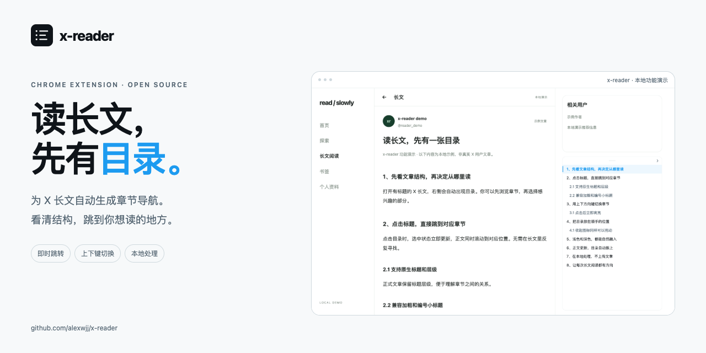
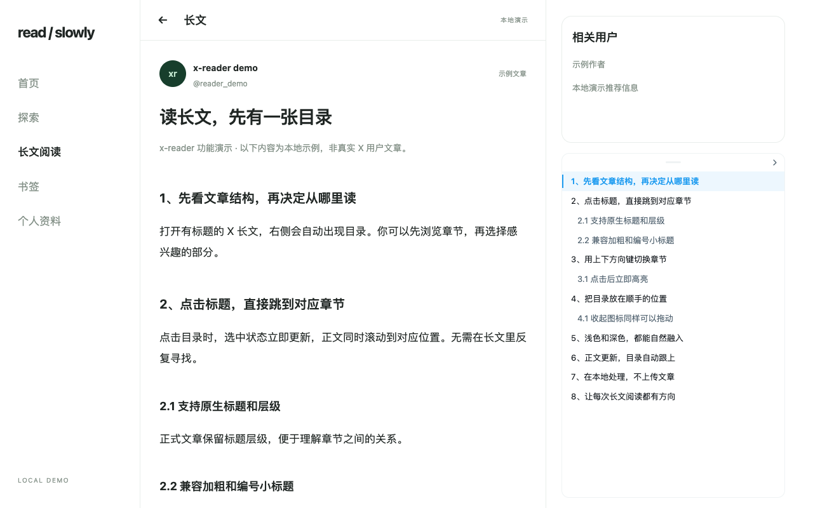
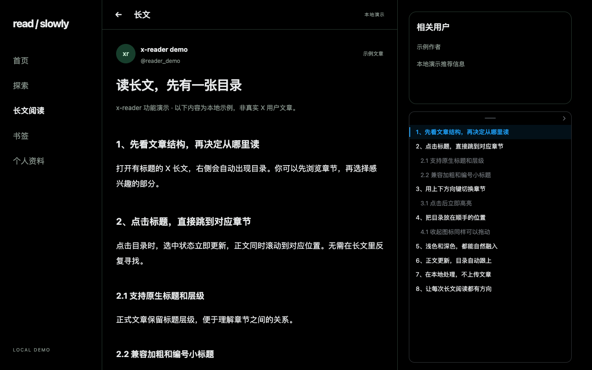
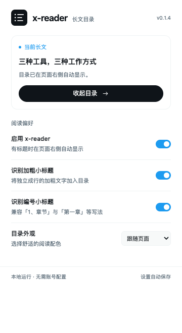
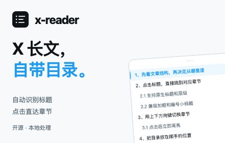

# x-reader



A clickable table of contents for long reads on X. Navigate headings from a floating panel beside the article, with the current section highlighted as you scroll.

[中文](README.md) · [Chrome Web Store publishing](docs/store/README.md) · [Privacy](PRIVACY.md) · [Report an issue](https://github.com/alexwjj/x-reader/issues) · [Changelog](CHANGELOG.md)

## Preview

| Light | Dark |
| --- | --- |
|  |  |

Screenshots show the actual extension running on local demonstration content, without real accounts or user articles.

<p align="center"></p>

## Features

- Supports X/Twitter post detail pages and Articles, using semantic headings, standalone bold lines and numbered section titles.
- Appears automatically when headings are available, with click-to-jump navigation and active-section tracking. Updates automatically as the article changes.
- Uses X-style colors, subtle borders, blue selection and 13px labels. Aligns with the right sidebar's trends card below related users, uses the sidebar width and extends toward the bottom of the viewport. No article title, extra numbering, counts or footer.
- Click or press Up/Down to select the previous/next chapter immediately while the article scrolls. Selection stays on the requested chapter throughout smooth scrolling; editors keep their normal arrow-key behavior.
- Drag the top grip or the collapsed icon to reposition it; both share the same position, and releasing a dragged icon does not open it. Focus either control and press Alt + arrow keys to move it. Hold Shift for larger steps.
- Opens beside the article when space allows. On narrow screens or when right-side space is limited, starts as a contrasting 36px outline icon that opens the panel.
- Offers page-following, light and dark themes, with preferences applied immediately.
- Manifest V3 and native JavaScript, with no build step or runtime dependencies. No background worker, remote API, AI or account configuration.

## Install

Requires **Chrome 116+**. Node.js and npm are only needed for development. The Chrome Web Store version has not been published yet; load the local source for now. Maintainers can follow the [publishing guide](docs/store/README.md).

1. Save the project locally, keeping `manifest.json`, `src/` and `icons/` together.
2. Open `chrome://extensions` and enable **Developer mode**.
3. Click **Load unpacked** and select the `x-reader/` project root directly. No build is required.
4. Optionally pin x-reader to the toolbar. **Refresh X tabs that were already open when you installed the extension.**

You can also extract the archive produced by `npm run zip` and load the extracted directory containing `manifest.json`. After editing or updating the source, reload the extension in the extension manager, then refresh the X page.

## Usage and settings

Open a post detail page (`/<user>/status/<number>`) or an article (`/<user>/article/<number>`, `/i/article/<number>` or `/i/articles/<number>`) on `x.com` or `twitter.com`, and expand the full text. The outline appears when headings are found. An empty panel stays hidden until you open it manually from the toolbar popup.

The popup shows page status, toggles the outline and saves preferences. Content changes update the outline automatically. The dragged position survives updates on the current page and resets when switching articles. Press `Esc` while focus is inside the outline to collapse it.

| Setting | Default | Behavior |
| --- | --- | --- |
| Enable x-reader | On | Disabling removes the panel and stops content observation; enabling resumes it. |
| Detect bold headings | On | Treats short, standalone, fully bold lines as heading candidates. |
| Detect numbered headings | On | Recognizes short lines such as `1、背景`, `第一章 起点` and `Chapter 1`. |
| Outline theme | `auto` | `auto` follows the page, `light` forces light colors, and `dark` forces dark colors. |

Semantic headings (`h1`–`h6` and `role="heading"`) remain enabled regardless of the bold and numbered detection switches. When native H1–H6 section headings exist, their structure takes priority over bold and numbered heuristics, keeping table labels and body references out of the outline. Preferences use `chrome.storage.local` and are not synced across devices.

## Privacy and permissions

The manifest requests only the `storage` permission for local preferences. Content scripts are limited to X/Twitter domains. Article text and outlines are processed in the current page's memory, without being saved or uploaded. The extension does not read login credentials, collect analytics or call private X APIs. It requires no X account configuration; access to page content remains subject to X's own requirements. See [PRIVACY.md](PRIVACY.md).

## Limits and troubleshooting

- **Only loaded DOM content is available.** Collapsed or unloaded text is absent from the outline. Expand or load the text, then wait for the outline to update automatically.
- **Heading detection uses imperfect heuristics.** Short numbered prose can be mistaken for a heading, and unusual formatting may be missed. Disable either heuristic as needed. Lists, quotations, code and hidden content are filtered.
- **Compatibility depends on X's actual DOM.** Site changes, experiments or different content containers can break article selection. If no outline appears, check that you are on a detail page, the extension is enabled and the page was refreshed after installation.
- Home feeds do not receive a combined outline. Full-text fetching, downloads, translation, AI summaries and access-control bypasses are outside the scope.
- Local fixture tests do not certify compatibility with the live X website.

## Store publishing and promotional assets



The store icon, two 1280×800 screenshots of the actual extension on local demo content, 440×280 small promo tile, 1400×560 marquee and README hero are available in [docs/store/](docs/store/README.md). Copy-ready [Chinese](docs/store/listing.zh-CN.md) and [English](docs/store/listing.en.md) listings are included.

```bash
npm run assets:store  # Regenerate images in isolated Chromium
npm run check:public # Check public dependency URLs, local paths and image sizes
```

The project `.npmrc` uses the public npm registry, and every locked package has a public download URL. The extension has no runtime npm dependencies. Development packages and local design notes are excluded from the extension ZIP.

## Development and packaging

Requires **Node.js 22+**. Run from the project root:

```bash
npm ci
npm run lint
npm test
npx playwright install chromium
npm run test:browser
```

`lint` runs static project checks; `npm test` covers DOM behavior and logic. Browser tests load the actual extension in isolated Chromium and intercept X network requests with local fixtures to check extension loading and interaction. They do not test the authenticated live X website or establish support for every real DOM variant. Test status is determined by actual command output.

```bash
npm run demo
```

View the local demo at `http://localhost:4173`. Content scripts still match only X/Twitter domains; the demo illustrates the interface and sample content without adding support for arbitrary websites.

```bash
npm run zip
```

Produces `dist/x-reader-0.1.4.zip`. Packaging uses a fixed file allowlist and includes extension runtime files regardless of whether they have been committed to Git. Development dependencies, tests and local demo resources are excluded.

```text
manifest.json       Extension declaration and permissions
src/content/        Article selection, heading extraction, panel and lifecycle
src/shared/         Defaults and local settings storage
src/popup/          Toolbar popup
icons/              Project icons
tests/              Tests and DOM fixtures
tools/              Checks, demo, browser tests and packaging
docs/               Architecture, design and screenshots
```

See [Architecture](docs/architecture.md) and [Contributing](CONTRIBUTING.md) for details. Future work focuses on reproducible article samples, better DOM adapters, fewer false heading matches and broader regression coverage.

## Reference and license

The organization of the project introduction, installation and settings documentation takes inspiration from [wangsen2020/x-media-downloader](https://github.com/wangsen2020/x-media-downloader). x-reader's descriptions and documentation are written independently, without reusing that project's branding or the official X logo.

Released under the [MIT License](LICENSE). x-reader is an independent project and is not affiliated with X.
