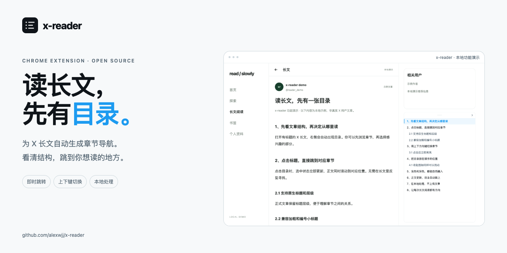
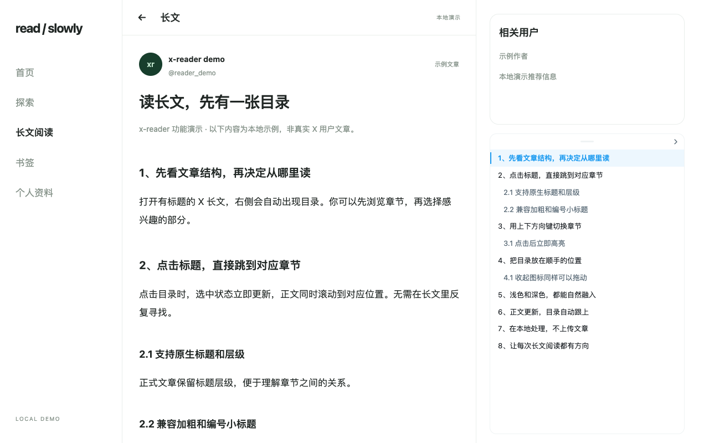
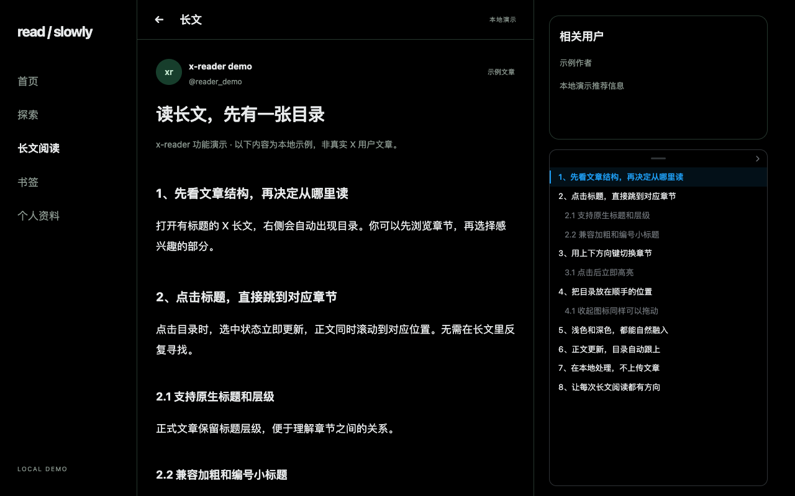

# x-reader



为 X 长文生成可点击的章节目录。保留原页面阅读体验，用右侧浮层快速定位小标题，滚动时同步标记当前章节。

[English](README.en.md) · [AI 安装](#ai-安装) · [隐私说明](PRIVACY.md) · [反馈问题](https://github.com/alexwjj/x-reader/issues) · [更新记录](CHANGELOG.md)

## AI 安装

**免费本地安装，无需商店账号或注册费。** 复制下面整段提示词，交给支持本机终端或浏览器操作的 AI 助手即可。只能聊天的 AI 也可以根据提示词带你手动安装。扩展运行本身不需要 AI。

```text
请帮我在本机 Chrome 中安装 x-reader，这是一个为 X/Twitter 长文自动生成章节目录的开源扩展。

仓库：https://github.com/alexwjj/x-reader

请先阅读仓库 README 和 manifest.json，再执行安装：
1. 有本机终端或文件操作能力时，直接把仓库下载到一个可长期保留的目录。优先使用 git clone；没有 Git 就下载并解压仓库的 main 分支 ZIP。已有同名目录时先检查内容，不要覆盖我的文件或未提交修改。没有本机操作能力时，请给我适合当前系统的简明步骤。
2. 找到直接包含 manifest.json、src/、icons/ 的项目根目录，检查入口文件和图标是否齐全。这个扩展无需构建，不要为安装运行 npm install、npm ci 或安装 Node.js、开发依赖。
3. 打开 chrome://extensions，协助我开启“开发者模式”，点击“加载已解压的扩展程序”，选择项目根目录。浏览器或系统要求我手动确认的步骤，请明确告诉我该点哪里，并提供目录的绝对路径。
4. 安装后刷新已打开的 X 页面，让我打开一篇带章节标题的长文并展开完整正文。确认右侧出现目录，点击标题可跳转，上下方向键可切换章节；没有标题的短帖不会自动出现目录。
5. 最后告诉我安装目录、实际完成了哪些步骤，以及之后如何更新：更新本地源码，在 chrome://extensions 重新加载扩展，再刷新 X 页面。提醒我保留安装目录，Chrome 仍需要读取其中的文件。

请直接完成你能操作的部分。遇到必须由我点击或确认的步骤再指导我操作；如果无法操作或验证浏览器，请如实说明，不要声称已经安装成功。不需要注册 Chrome Web Store 开发者，也不需要支付商店注册费。
```

## 阅读效果

| 浅色目录 | 深色目录 |
| --- | --- |
|  |  |

以上截图由实际扩展加载本地示例文章生成，不包含真实账号或用户文章。

<p align="center"></p>

## 功能

- 支持 X/Twitter 帖子详情页与 Articles 阅读页，识别正文中的语义标题、独立加粗行和编号小标题。
- 有标题时自动显示，点击章节跳转，滚动同步高亮；正文变化后自动更新，无需手动刷新。
- 使用 X 风格配色、细边框和蓝色选中态；默认对齐右侧栏“有什么新鲜事”区域，宽度跟随侧栏，从相关用户卡片下方向窗口底部延伸，采用 13px 字号。无文章标题、额外序号、数量徽标或底部说明。
- 点击或按上下方向键立即选中上一节/下一节，同时滚动正文；平滑滚动途中保留目标选中态，不干扰输入框和回复编辑器。
- 展开时拖动顶部短横条、收起时直接拖动图标，二者共享位置；拖动图标不会误展开。聚焦后按 Alt + 方向键移动，按住 Shift 加快移动。
- 空间足够时在正文右侧展开；窄屏或右侧空间不足时默认显示 36px 的反色目录图标，点击打开浮层。
- 目录提供跟随页面、浅色、深色三种主题，设置保存后即时生效。
- Manifest V3、原生 JavaScript、无编译步骤、无运行时依赖。无后台、远程接口或 AI，无需账号配置。

## 安装

需要 **Chrome 116+**，无需 Node.js、npm 或付费。项目通过本仓库分发，按下面的步骤加载本地源码，也可以直接使用上面的 [AI 安装提示词](#ai-安装)。

1. [下载源码 ZIP](https://github.com/alexwjj/x-reader/archive/refs/heads/main.zip) 并解压到长期保留的目录，或克隆本仓库；确保目录内有 `manifest.json`、`src/` 和 `icons/`。
2. 打开 `chrome://extensions`，开启右上角的“开发者模式”。
3. 点击“加载已解压的扩展程序”，直接选择项目根目录 `x-reader/`，无需构建。
4. 可将 x-reader 固定到工具栏。**安装后刷新此前已打开的 X 页面**，让内容脚本生效。

也可以解压通过 `npm run zip` 生成的发布包，再加载解压后包含 `manifest.json` 的目录。更新源码后，在扩展管理页点击“重新加载”，再刷新 X 页面。

## 使用与设置

打开 `x.com` 或 `twitter.com` 的帖子详情页（`/<用户>/status/<数字>`）或文章页（`/<用户>/article/<数字>`、`/i/article/<数字>` 或 `/i/articles/<数字>`），先展开完整正文。识别到标题后会显示目录；没有标题时不自动显示空面板，可从工具栏弹窗手动展开查看提示。

工具栏弹窗展示当前页面状态，可展开/收起目录并修改偏好。目录自动响应正文变化。拖动位置在当前页面保留，切换文章后恢复默认位置。按 `Esc` 可收起已聚焦的目录浮层。

| 设置 | 默认值 | 说明 |
| --- | --- | --- |
| 启用 x-reader | 开启 | 关闭时移除目录并停止正文观察；再次开启后恢复。 |
| 识别加粗小标题 | 开启 | 将独立成行、整行加粗的短文本作为候选标题。 |
| 识别编号小标题 | 开启 | 识别 `1、背景`、`第一章 起点`、`Chapter 1` 等短行。 |
| 目录外观 | `auto` | `auto` 跟随页面明暗，`light` 固定浅色，`dark` 固定深色。 |

语义标题（`h1`–`h6`、`role="heading"`）不受加粗与编号开关影响。正文已有原生 H1–H6 章节标题时优先采用原生层级，避免把表格表头或正文中的加粗提示混入目录。所有偏好保存于 `chrome.storage.local`，不跨设备同步。

## 隐私与权限

清单仅申请 `storage` 权限，用于本地偏好；内容脚本匹配范围限于 X/Twitter 域名。正文与目录只在当前页面内存中处理，不持久保存、不上传；不读取登录凭证、默认启用匿名使用统计（仅扩展界面），可在弹窗中关闭；仅请求固定 Hub 接收域名权限、不调用 X 私有接口。扩展本身无需配置 X 账号，页面可见内容仍取决于 X 的访问要求。详见 [PRIVACY.md](PRIVACY.md)。

## 限制与排查

- **只识别已加载到 DOM 的正文**：折叠或尚未加载的内容不会出现在目录中；展开、滚动加载后等待目录自动更新。
- **启发式不完美**：短编号正文可能误判，特殊排版可能漏判。可分别关闭加粗或编号识别；普通列表、引用、代码、隐藏内容等会被过滤。
- **依赖真实 X DOM 结构**：站点改版、实验界面或容器变化可能导致正文定位失效。没有目录时，先确认处于详情页、扩展已启用且安装后已刷新页面。
- 不为首页信息流生成混合目录，不提供全文抓取、下载、翻译、AI 摘要或访问限制绕过。
- 本地浏览器测试使用受控 fixture，不能作为真实线上 X 的兼容认证。

## 宣传素材


项目图标、两张 1280×800 实际扩展演示截图、440×280 小推广图、1400×560 横幅和 README 头图均保存在 [docs/store/](docs/store/)，可用于介绍或分享项目。素材按商店通用尺寸准备，使用扩展仍按上方的免费本地安装方式进行。

```bash
npm run assets:store  # 使用隔离 Chromium 重新生成图片
npm run check:public # 检查公开 npm 来源、敏感路径与图片尺寸
```

项目级 `.npmrc` 固定使用公共 npm registry；锁文件中所有依赖均为公开下载地址。扩展没有运行时 npm 依赖，本地开发依赖与设计过程笔记不会进入安装包。

## 开发与打包

需要 **Node.js 22+**。在项目根目录执行：

```bash
npm ci
npm run lint
npm test
npx playwright install chromium
npm run test:browser
```

`lint` 执行工程静态检查，`npm test` 执行 DOM 与逻辑测试。浏览器测试在隔离的 Chromium 中加载真实扩展，将 X 网络请求拦截为本地 fixture，以验证扩展加载与交互；它不验证登录后的线上 X，也不代表所有真实 DOM 版本均受支持。测试结果以实际运行输出为准。

```bash
npm run demo
```

在 `http://localhost:4173` 查看本地演示。内容脚本只匹配 X/Twitter 域名；演示用于展示界面与样例，不代表新增任意网站支持。

```bash
npm run zip
```

生成 `dist/x-reader-0.1.4.zip`。打包使用固定文件白名单，仅纳入扩展运行文件，不依赖文件是否已被 Git 提交；不包含开发依赖、测试和本地演示资源。

```text
manifest.json       扩展声明与权限
src/content/        正文定位、标题识别、目录与页面生命周期
src/shared/         默认设置与本地存储
src/popup/          工具栏弹窗
icons/              项目图标
tests/              测试与 DOM fixture
tools/              检查、演示、浏览器验证与打包脚本
docs/               架构、设计与截图
```

实现细节见 [架构说明](docs/architecture.md)，提交约定见 [贡献指南](CONTRIBUTING.md)。后续改进重点是依据可复现文章样例完善正文适配、减少标题误判并扩充回归覆盖。

## 参考与许可

工程介绍、安装与配置文档的组织参考 [wangsen2020/x-media-downloader](https://github.com/wangsen2020/x-media-downloader)。x-reader 的功能说明与文档独立撰写，不沿用其品牌素材，也不使用 X 官方标志。

采用 [MIT License](LICENSE)。x-reader 是独立项目，与 X 无隶属关系。
