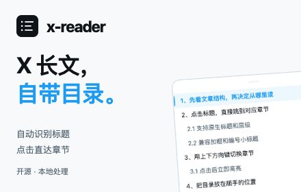
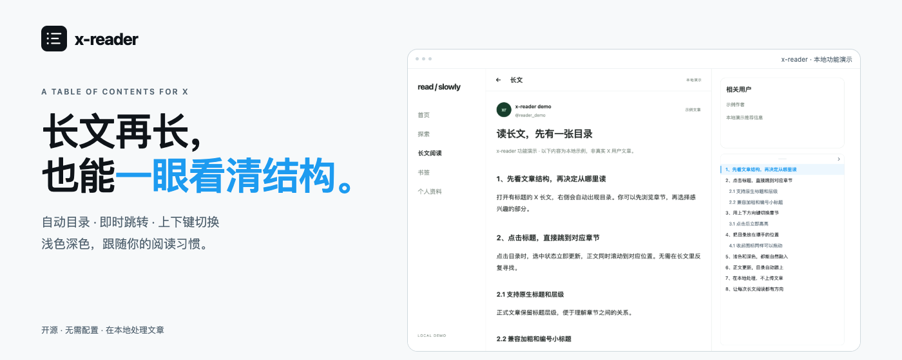

# Chrome Web Store 发布

当前扩展版本为 **0.1.4**。本文与图片规格于 2026-11-03 根据 Chrome 官方文档整理。仓库提交、ZIP 生成与商店审核是不同步骤；本项目不声明已经上架。

## 1. 准备开发者账号

1. 使用准备长期维护扩展的 Google 账号，打开 [Chrome Web Store Developer Dashboard](https://chrome.google.com/webstore/devconsole)。
2. 开启 Google 账号两步验证。发布新扩展和更新扩展均需要 2FA。
3. 注册开发者并支付一次性注册费。Chrome 官方公告列为 **5 美元**，以注册页面实际结算为准。
4. 按后台要求补齐开发者联系信息和验证，确认发布者名称与分发地区。

注册付款、身份/联系方式验证需要由账号持有人完成。仅将文件推送到 GitHub 不会提交商店审核。

## 2. 上传扩展 ZIP

在项目根目录执行：

```bash
npm ci
npm run check:public
npm run lint
npm test
npx playwright install chromium
npm run test:browser
npm run zip
```

上传 **`dist/x-reader-0.1.4.zip`**。ZIP 根目录直接包含 `manifest.json`，不要上传外层文件夹或 GitHub 的整个源码 ZIP。打包白名单仅包括运行文件和许可/说明，不包括 `node_modules`、测试、开发工具或宣传图。商店图片在后台单独上传。

Dashboard → 新建项目 → 上传 ZIP。首次上架可以使用 0.1.4；以后每次更新必须递增 `manifest.json` 与 `package.json` 的版本，保持锁文件同步。

## 3. 填写商店信息

可直接参考 [中文商店文案](listing.zh-CN.md) 和 [英文商店文案](listing.en.md)。默认名称为 **x-reader**，推荐选择与生产力或阅读工具相关的现有类别，具体以后台选项为准。

| 字段 | 填写内容 |
| --- | --- |
| 官方网站 / Homepage | `https://github.com/alexwjj/x-reader` |
| 支持网址 / Support | `https://github.com/alexwjj/x-reader/issues` |
| 隐私政策 URL | `https://github.com/alexwjj/x-reader/blob/main/PRIVACY.md` |
| 语言 | 中文（简体）；可另添加英文商店说明 |
| 价格 | 免费，若这是你的发布选择 |

隐私政策 URL 必须无需登录即可访问。首次推送到公开仓库之后再提交该地址；后续保持地址稳定并同步扩展行为。

## 4. 上传图片

所有 PNG 均已在本地生成，可直接提交或在 README 中使用。图标与至少一张截图是必需项；两种推广图按当前官方指南为可选项。

| 用途 | 本地文件 | 尺寸 |
| --- | --- | --- |
| 商店图标 | [store-icon-128.png](store-icon-128.png) | 128 × 128，透明边距 |
| 浅色截图 | [screenshot-light-1280x800.png](screenshot-light-1280x800.png) | 1280 × 800 |
| 深色截图 | [screenshot-dark-1280x800.png](screenshot-dark-1280x800.png) | 1280 × 800 |
| Small promo tile | [promo-small-440x280.png](promo-small-440x280.png) | 440 × 280 |
| Marquee promo tile | [promo-marquee-1400x560.png](promo-marquee-1400x560.png) | 1400 × 560 |
| README 头图 | [readme-hero-1280x640.png](readme-hero-1280x640.png) | 1280 × 640，仅用于项目宣传 |

商店接受 1–5 张截图，推荐 1280 × 800，也接受 640 × 400。不要把 README 头图当作商店截图上传。





图片由实际扩展加载本地示例 DOM 生成，示例明确标注“本地演示”，不包含真实用户资料、私有文章或 X 官方标志。商店图标和 x-reader 品牌图形由项目自行制作。它们不是商店已批准或官方背书的证明。

重新生成素材：

```bash
npm run assets:store
npm run check:public
```

生成器使用隔离 Chromium，不读取个人 Chrome 配置或登录状态。文字排版可能因系统字体略有变化。提交前检查图片，必要时重新生成。

## 5. 填写 Privacy practices

以下内容是根据当前代码准备的填写依据，发布者需对后台最终勾选内容负责。**不上传数据不等于没有在本地访问或处理网页内容。**

### 单一用途

> 在 X/Twitter 的帖子详情页和文章阅读页，根据已加载的正文标题在本地生成章节目录，帮助用户预览文章结构并定位阅读位置。

### 权限与网站访问理由

| 项目 | 可粘贴的用途说明 |
| --- | --- |
| `storage` | 使用 `chrome.storage.local` 在当前浏览器保存启用状态、加粗/编号标题识别开关和主题偏好。不保存文章正文、阅读历史，不使用 Chrome Sync。 |
| X/Twitter 网站访问 | 内容脚本限定在 HTTPS 的 x.com、twitter.com 及其 www 域名，用于读取当前受支持长文页面中已加载的标题/正文 DOM、插入本地目录并响应导航。不会访问其他网站或调用 X 私有接口。 |
| 远程代码 | 不使用远程代码。所有执行逻辑都随扩展包分发，本地 ES Modules 通过扩展 URL 加载，不下载或执行远程脚本，不使用 eval。 |

清单只有 `storage` 这一项 API 权限，但 `content_scripts.matches` 同样赋予对应网站的内容脚本访问能力，不应在商店声称“无网站访问权限”。

### 数据类别与用途

- **Website content / 网站内容**：实际会访问并在本地处理当前长文的标题、正文及页面路径，应在数据说明中明确披露。若后台将此类本地处理纳入该复选框范围，按该范围申报并说明仅用于本地章节导航；不要仅因“未上传”而直接把所有数据类别均选为否。
- 不收集或上传身份信息、健康信息、财务信息、登录凭据、私人通信、位置、浏览历史或行为分析数据。不使用 cookies/history API；当前页面路径仅用于识别阅读路由，不保存为浏览历史。
- 不向开发者服务器或第三方传输文章/网址，不出售数据，不用于广告、信用评估或与单一用途无关的目的。
- 偏好设置只保存在 `chrome.storage.local`。关闭页面会释放正文与目录的内存状态，卸载扩展会移除本地偏好。

Chrome 文档明确要求披露本地处理，但没有在公开指南中穷尽所有当前复选框边界。提交时应以后台字段定义、实际代码和隐私政策为准，保持三者一致；完成 Limited Use 等相关确认。

### 审核测试说明

可粘贴：

> 安装后刷新 X/Twitter 页面，打开有章节标题的帖子详情页或 Articles 页面，并展开已获访问权限的完整正文。扩展无需额外账号、API 密钥或付费配置；X 页面自身可能要求登录。识别到标题后，在右侧显示目录。点击条目跳转，上下方向键切换，顶部短横条和收起图标均可拖动。通过工具栏弹窗可启停或改变主题。首页信息流不显示合并目录，普通无标题短帖也不会自动显示目录。不绕过 X 的访问限制。

不要把自己的 Cookie、登录密码或个人浏览器配置提交到测试说明。若审核后台要求可访问的测试 URL，应选择公开且已确认具有章节标题的实际文章；仓库截图是本地演示，不冒充线上文章样本。

## 6. 提交审核与发布

补齐 Store listing、Privacy practices、分发范围和必要说明后，提交审核。可以选择审核通过后自动发布，也可以关闭自动发布、通过后手动发布。延后发布时，官方要求批准后 30 天内发布，否则会退回草稿并需重新审核。审核没有保证完成时间。

上架取得真实商店 URL 后，再把该地址加入中英文 README。当前不放置虚构商店链接、安装量、评分或审核状态。

## 官方参考

- [开发者注册](https://developer.chrome.com/docs/webstore/register)
- [注册费官方公告](https://developer.chrome.com/blog/cws-role-expansion-developer-dashboard)
- [两步验证要求](https://developer.chrome.com/docs/webstore/program-policies/two-step-verification)
- [准备 ZIP](https://developer.chrome.com/docs/webstore/prepare)
- [商店信息填写](https://developer.chrome.com/docs/webstore/cws-dashboard-listing)
- [图片规格](https://developer.chrome.com/docs/webstore/images)
- [隐私政策要求](https://developer.chrome.com/docs/webstore/program-policies/privacy)
- [本地处理与用户数据 FAQ](https://developer.chrome.com/docs/webstore/program-policies/user-data-faq)
- [Privacy practices](https://developer.chrome.com/docs/webstore/cws-dashboard-privacy)
- [API 权限与网站访问](https://developer.chrome.com/docs/extensions/develop/concepts/declare-permissions)
- [Manifest V3 远程代码要求](https://developer.chrome.com/docs/webstore/program-policies/mv3-requirements)
- [审核与发布](https://developer.chrome.com/docs/webstore/publish)
